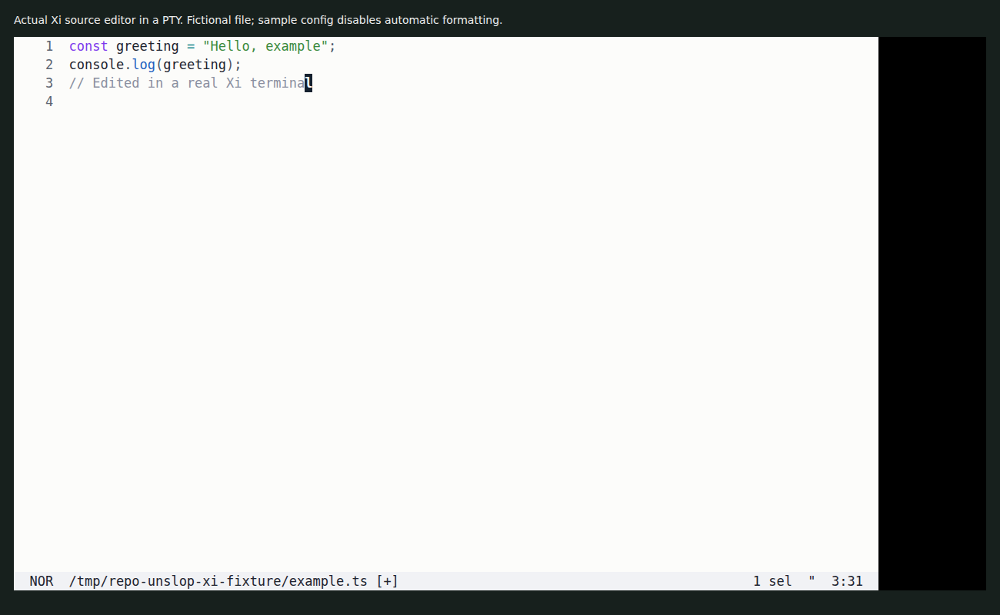

# Xi

A terminal code editor with Vim-style editing, multiple selections and optional language-server, Git and filesystem tools. It has its own editing engine and runs on Bun and OpenTUI.



The capture is an actual PTY session. The sample configuration disables automatic formatting because Biome was not installed. [Capture commands and limits](docs/demo/README.md).

## Try it from source

Use Bun 1.4.2 or newer within the supported 1.x range, plus Git:

```sh
git clone https://github.com/olegpustovit/xi.git
cd xi
git submodule update --init --recursive
bun install --frozen-lockfile
cp docs/demo/example.ts /tmp/xi-example.ts
bun run apps/xi/src/main.ts -c docs/demo/config.toml /tmp/xi-example.ts
```

The sample configuration turns off automatic formatting, so saving the example does not require a formatter executable. In the normal TypeScript configuration, saving can invoke Biome; a missing executable blocks that formatted save. Configure or install your desired formatter before enabling it.

Use `i` to insert text, Escape to return to normal mode, `:w` to save and `:q` to quit. For the tutorial:

```sh
bun run apps/xi/src/main.ts -c docs/demo/config.toml --tutor
```

The file-edit/save path was checked. The tutorial was not exercised in this capture.

## Build a binary

```sh
bun run package:build
./dist/xi -c docs/demo/config.toml /tmp/xi-example.ts
```

The packaged Linux ARM64 build also passed the edit/save check. [Installation and packaging](docs/installation/README.md) covers releases and other targets; those targets were not qualified here.

The separate development-bundle command, `bun run xi`, failed in this checkout with a relative Tree-sitter WebAssembly asset lookup. Use the direct source or packaged path above for this example. The unresolved bundle issue is recorded in the capture notes.

## Status

The active scope is Helix-compatible configuration, while Neovim remains a development reference for Vim behavior. Complete parity is not established. The checked ledger reports 153 effective settings, 10 incompatible settings and two missing settings, with 1117 of 1141 checks proved. See the [configuration guide](docs/configuration.md) and [machine-readable ledger](docs/configuration-ledger.json) for the individual results.

The contributor contract also keeps the loaded latency comparison open. This documentation capture does not close that performance gate, certify all Vim or multi-selection behavior, or test optional LSP/Git integrations. Neovim and Helix are development references, not required editor subprocesses.

## Development and reference

```sh
bun run check
```

The toolchain, type, public-boundary, configuration-ledger and lint checks passed for this review. No product runtime code was changed. Broader behavioral and performance checks remain separate:

- [Architecture](docs/architecture.md)
- [Configuration](docs/configuration.md)
- [Testing](docs/testing.md)
- [Performance](docs/performance.md)
- [Vim behavior](docs/vim.md)
- [Capture details](docs/demo/README.md)
- [MIT license](LICENSE)

The [website](https://olegpustovit.github.io/xi/) provides the broader user guide.
